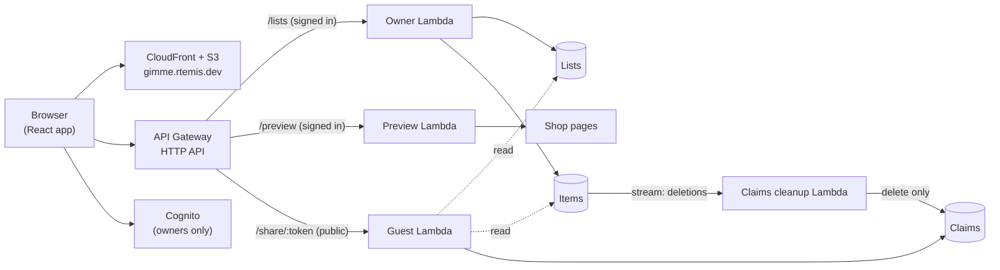

# gimme

**Wishlists that keep the surprise.**

Make a wishlist from any shop, share one link, and let friends and family claim gifts. Guests can see what's taken, so nobody buys the same thing twice. You never see who claimed what.

Live at [gimme.rtemis.dev](https://gimme.rtemis.dev) (invite-only for now).

## Features

- **Add from any shop.** Paste a product link and gimme fills in the name, photo, shop and price. You can add sizes, notes, tags and links to other shops.
- **Your order.** Drag items to rank them, or sort and filter by price, shop or tag.
- **One share link.** Guests open it in the browser, with no account and nothing to install. If a link ends up with the wrong people, replace it with a new one.
- **Private claims.** Guests claim items, optionally with their name, and can unclaim later from the same browser. The list owner's view never shows claims, and this is enforced on the server.
- **Phone-first.** Works well on small screens, with light and dark themes.

## How claims stay secret

The backend makes sure owners can't see claims; the UI doesn't just hide them.

- Owner requests and guest requests go to **separate Lambda functions with separate IAM roles**.
- The owner function has **no permission on the Claims table at all**, so no bug or crafted request on the owner side can read a claim.
- Guests have no accounts. They reach a list only through its unguessable share token. Claiming returns a secret that stays in the guest's browser and is needed to unclaim.
- When an owner deletes an item, a separate function picks up the deletion from the Items table's stream and removes the matching claim. That function can delete claims but can't read them.

## Architecture



| Part                    | What it is                                                                                             |
| ----------------------- | ------------------------------------------------------------------------------------------------------ |
| `frontend/`             | React 19 + Vite + Tailwind CSS 4 + shadcn/ui. Data fetching with TanStack Query, sign-in with Amplify. |
| `lambda/owner`          | Owner API (Hono): lists, items, ordering, share links.                                                 |
| `lambda/guest`          | Guest API (Hono): read a shared list, claim, unclaim.                                                  |
| `lambda/preview`        | Fetches a product page and pulls out its name, image, shop and price. It has no database access.       |
| `lambda/claims-cleanup` | Removes claims for deleted items. Failures go to an SQS dead-letter queue.                             |
| `lambda/auth-emails`    | Rewrites Cognito's emails (sign-in codes, invites) in gimme's voice.                                   |
| `lib/`                  | AWS CDK infrastructure: DynamoDB tables, API, Cognito, site hosting.                                   |

Owners sign in with an emailed one-time code (or a password). Sign-ups are turned off, so accounts are created by invitation.

## Running locally

You need Node.js 22+.

```sh
npm ci
npm ci --prefix frontend
```

The frontend reads its API and Cognito settings from `frontend/public/config.json` at runtime. Get that file from the deployed stack (needs AWS credentials):

```sh
npm run config:pull --prefix frontend
npm run dev
```

Then open http://localhost:5173. The deployed API already allows requests from that address.

To look at the logged-out pages without AWS, write any placeholder values into `frontend/public/config.json`:

```json
{
  "apiUrl": "http://localhost:9",
  "userPoolId": "eu-west-2_AAAAAAAAA",
  "userPoolClientId": "aaaaaaaaaaaaaaaaaaaaaaaaaa"
}
```

The landing page renders with these, but sign-in and lists won't work.

## Deploying

The app deploys as two CDK stacks:

- `WishlistCertificateStack`, in `us-east-1`: the TLS certificate. CloudFront requires certificates in that region.
- `WishlistStack`, in `eu-west-2`: everything else.

1. Sign in to AWS (`aws login`, `aws configure sso` or `aws configure`) and check it with `aws sts get-caller-identity`.
2. In a new AWS account only, bootstrap CDK in both regions:
   ```sh
   npx cdk bootstrap aws://<ACCOUNT_ID>/eu-west-2 aws://<ACCOUNT_ID>/us-east-1
   ```
3. Build the frontend and deploy both stacks:
   ```sh
   npm run deploy
   ```

The deploy uploads the built site and writes `config.json` next to it, so the live site needs no extra setup.

To run it on your own domain, change `domainName`, `hostedZoneId` and `zoneName` in `bin/wishlist.ts` to a Route 53 hosted zone you own.

### Inviting someone

Sign-ups are disabled, so you create accounts yourself. The `PoolID` comes from the stack outputs.

```sh
aws cognito-idp admin-create-user \
  --region eu-west-2 \
  --user-pool-id <PoolID> \
  --username friend@example.com \
  --user-attributes Name=email,Value=friend@example.com Name=email_verified,Value=true
```

They get an invite email and can then sign in with a code sent to that address.

## Commands

Run from the repo root unless noted.

| Command                           | What it does                                      |
| --------------------------------- | ------------------------------------------------- |
| `npm run dev`                     | Start the frontend dev server                     |
| `npm run deploy`                  | Build the frontend and deploy both stacks         |
| `npm test`                        | Run the infrastructure tests (Jest)               |
| `npm run build`                   | Type-check the CDK app                            |
| `npx cdk diff`                    | Compare local infrastructure with what's deployed |
| `npm run lint --prefix frontend`  | Lint the frontend (oxlint)                        |
| `npm run build --prefix frontend` | Type-check and build the frontend                 |

## License

[MIT](LICENSE) © Pedro Portela
